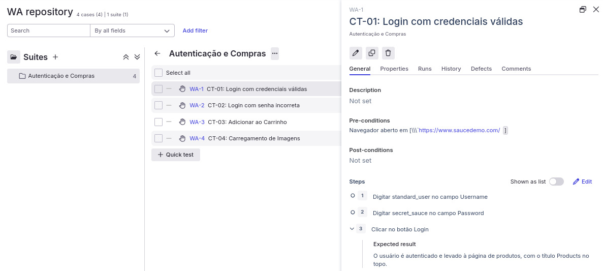
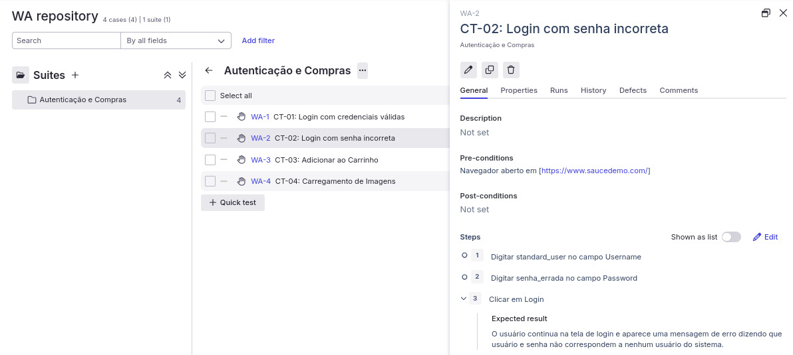
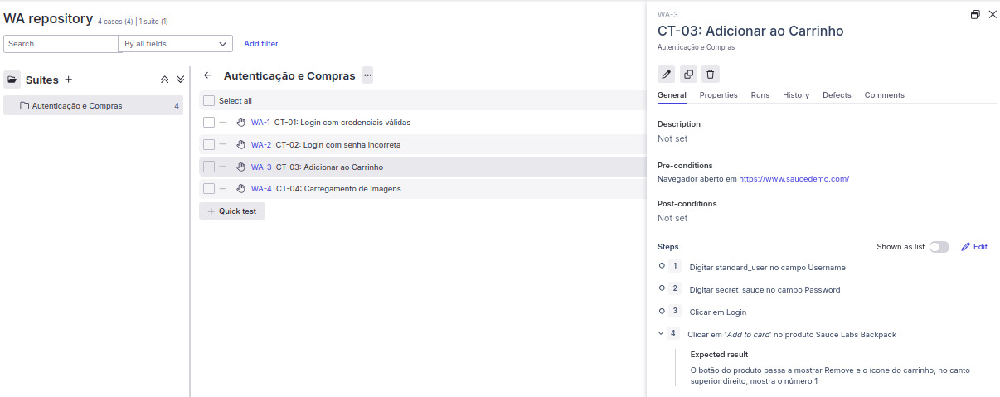
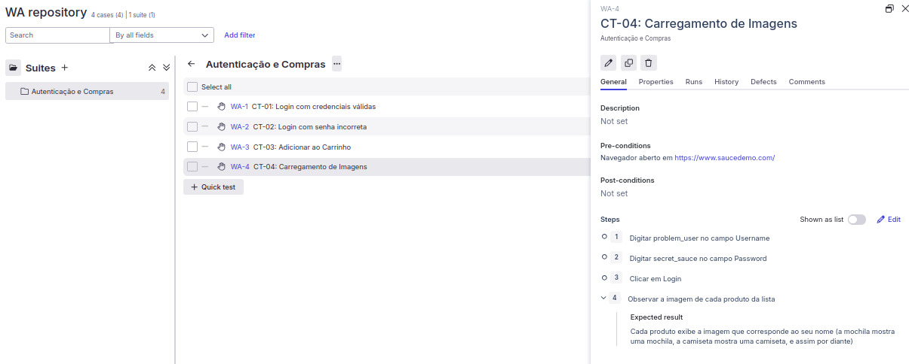
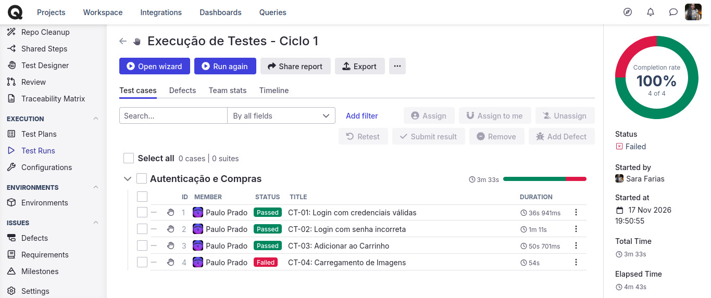

# Atividade: Primeiro Teste de Software

**Estudante:** Sara Luiz de Farias e Paulo Martins Alves do Prado

**Curso e período:** Bacharelado em Sistemas de Informação, 8º período

**Disciplina:** Teste de Software

## Sistema testado
SauceDemo (https://www.saucedemo.com/)

## Classificação do teste realizado
* **Nível:** Teste de sistema, pois avalia a loja virtual completa pelo navegador simulando o uso de um cliente final.
* **Objetivo:** Teste funcional, pois verifica se as funcionalidades da loja fazem exatamente o que deveriam fazer.
* **Visão do código:** Teste de caixa-preta, pois a avaliação ocorre apenas pela interface visual e resultados na tela, sem acesso ao código-fonte.
* **Execução:** Teste dinâmico, pois exige que o sistema esteja em funcionamento real para ser operado.
* **Modo:** Teste manual, pois todos os passos e verificações foram executados diretamente por uma pessoa sem uso de scripts.
* **Motivo:** Teste novo, pois representa a primeira execução planejada para validar o comportamento atual do sistema.
  
## Casos de teste

## Execução

## Defeito encontrado
https://github.com/PauloMAPrado/relatorio-de-bugs-lab/issues/1

## Respostas às perguntas para refletir
**1. Por que o resultado esperado é escrito antes de executar o teste?**
Para evitar que a pessoa testadora seja influenciada pelo comportamento que vê na tela e acabe aceitando um defeito como se fosse o funcionamento normal do sistema.

**2. Qual a diferença entre o caso de teste (CT-04) e o relatório de defeito (a issue)? Por que precisamos dos dois?**
O caso de teste é o roteiro planejado que descreve o que deve ser verificado e o resultado esperado, enquanto o relatório de defeito (issue) documenta a falha específica encontrada durante a execução, com evidências e passos para reproduzi-la.

**3. Quatro casos passaram ou falharam. Podemos afirmar que a loja não tem mais nenhum defeito além do que você encontrou? Justifique.**
Não, pois esses quatro testes verificaram apenas cenários específicos de login, carrinho e imagens. Como não é possível testar todas as funcionalidades e situações possíveis da loja, outros defeitos podem existir nas partes que ainda não foram avaliadas.   

**4. Se essa loja fosse da sua empresa, o que você testaria a seguir?**
Testaria o fluxo completo de fechamento de compra, incluindo o preenchimento de dados obrigatórios, cálculo, remoção de itens do carrinho e filtros de ordenação de produtos.

**5. Classificação do teste:**
A resposta da pergunta 5 está na seção "Classificação do teste realizado".

**6. Explique por que ele não é um teste unitário nem um teste de carga.**
Não é um teste unitário porque não avalia pequenas partes isoladas do código, mas sim a aplicação inteira pela interface. Também não é um teste de carga porque foi executado por apenas um usuário em uso normal, sem simular milhares de acessos simultâneos para medir o limite do servidor.
